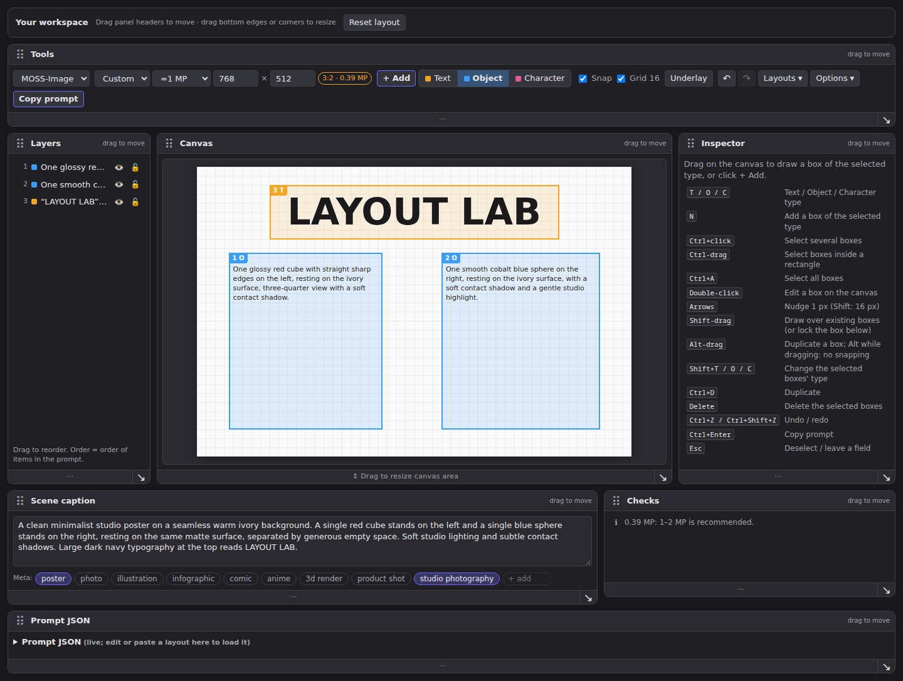

# Forge Layout Editor

A visual layout prompt editor for **Forge Neo**. Draw regions, describe subjects
and exact text, and generate through Forge's native txt2img workflow. Panels can
move and resize, and the scene caption grows without shrinking the canvas.

**Currently supported format: MOSS-Image.** The editor uses model format profiles
so additional layout-aware models can be supported in the future. Renaming the
extension does not add support for models that do not understand layout prompts.



## Install

In Forge Neo, use **Extensions → Install from URL** with
`https://github.com/a-l-e-x-d-s-9/forge-layout-editor`,
then restart Forge and reload the browser. Alternatively, clone or copy this
repository into `sd-webui-forge-neo/extensions/forge-layout-editor`.

Open the **Forge Layout Editor** tab. Runtime assets are local: no npm build,
extra pip package, external model service, or separate API key is required.

If upgrading from the original **MOSS Layout** extension, disable or remove the
old extension directory first to avoid duplicate tabs. This version retains the
shared saved-layout keys and reads the old workspace and LoRA preferences when
new preferences are not present. Restart Forge after replacing the extension.

## Create a layout

1. Select a supported checkpoint and its text encoder/VAE in Forge. Set sampler,
   schedule, steps, CFG, seed and other generation settings in **txt2img**.
2. In **Forge Layout Editor**, set the image width and height in **Tools**.
3. Pick **Object**, **Character** or **Text** and drag on the canvas, or use
   **+ Add**. Write a caption for every region. Text regions also require the
   exact words to render. Write the overall description in **Scene caption**.
4. Click **Generate** at the top right, or press **Ctrl+Enter**. The editor sends
   the prompt and dimensions through Forge's normal txt2img controls. Returned
   images appear in **Results** and as a canvas underlay. **Keep seed** reuses
   the most recent result's seed.

**Send to txt2img** and **Send to img2img** replace the destination's positive
prompt and dimensions, then open that tab. img2img generation stays in Forge's
img2img UI. **Load txt2img** imports a layout using that tab's current dimensions.
The optional **LoRA tags** field appends tags such as `<lora:name:1>`; copied JSON
contains only the layout.

Sending a layout turns off **Dynamic Prompts enabled** in the destination's
current browser controls because that extension otherwise interprets JSON braces
as prompt variants. Saved defaults are untouched. Enable Dynamic Prompts again
when returning to ordinary prompts.

Generation uses the current txt2img model, batch settings, high-resolution
settings, scripts and other extensions. Start with one image and high-resolution
processing disabled when comparing layouts. Boxes guide composition; they do not
guarantee exact object boundaries or pixel-perfect model output.

## Arrange the workspace

- Drag a panel header or dotted grip to move it before or after another panel.
  Tools, Layers, Canvas, Inspector, Scene caption, Checks, Results, Generation
  settings and Prompt JSON can all move.
- Drag the bottom edge to adjust height. The canvas has a labeled **Drag to
  resize canvas area** handle. Drag a **↘ corner** to change width and height;
  widths snap to workspace columns.
- Resize the Scene caption textarea from its corner. It adds space below the
  canvas, keeping the canvas height unchanged.
- Panel order, sizes and caption height save in this browser. **Reset layout**
  restores the panels while retaining prompts, regions and image dimensions.
- Focus a dotted grip and use ↑/↓ or Home/End to reorder panels. On a resize
  handle, arrows resize and Home restores that panel's default size.

On narrow windows, panels stack vertically. Resizing a workspace panel only
changes the view; the image resolution still comes from Tools.

## Editing and saved layouts

Drag a region to move it and use its handles to resize it. Double-click to edit.
Shift-drag draws over existing regions; Alt-drag duplicates. Ctrl-click selects
multiple regions. Layers support reordering, locking and hiding; hidden regions
are omitted from the prompt.

| Shortcut | Action |
| --- | --- |
| T / O / C | Choose Text / Object / Character |
| N | Add a region |
| Arrows / Shift+arrows | Nudge regions 1 / 16 pixels |
| Ctrl+Z / Ctrl+Shift+Z | Undo / redo |
| Ctrl+D | Duplicate selected regions |
| Delete | Delete selected regions |
| Ctrl+Enter | Generate, or copy in standalone mode |

**Layouts → Save as…** stores named layouts in this browser. Autosave restores
after reload. Export files for backups and use on another machine:

- **Save draft** downloads a portable MOSS JSON draft with image dimensions and
  absolute pixel boxes.
- **Layouts → Export .json file** also preserves editor state, including locks
  and hidden regions.
- Import either file type, or paste a draft/compiled prompt in **Prompt JSON**.

See [examples/layout-lab.json](examples/layout-lab.json) for an editable example.

## Format profiles

Profiles live in `javascript/01-le-formats.js`, using a model-independent editor
model from `00-le-model.js`. A profile supplies supported item types, fields,
validation and prompt import/export. Contributions for other models should add
an explicit profile and document the model's actual layout vocabulary.

The initial MOSS profile compiles drafts from `abs` / `xyxy` pixel coordinates
into compact `abs_centralized` / `yxyx` JSON. It floors left/top and ceils
right/bottom before centering, following the
[OpenMOSS compiler](https://github.com/OpenMOSS/MOSS-Image/blob/main/skills/moss-image-prompt-enhancer/scripts/compile_prompt.py).
Dimensions belong to the draft and Forge controls; they are omitted from the
compiled prompt. A compiled prompt must be loaded with its original image size.

Draft dimensions, exact Unicode text, line breaks, tags and palettes are
preserved. Invalid geometry, unknown fields, missing captions and missing text
are rejected. Overlap is allowed. Changing image dimensions in Tools scales the
existing regions proportionally; importing a draft keeps its declared geometry.

## Standalone and development

Open `standalone/index.html` directly in a browser to edit and copy prompts
without running Forge. Only the Forge tab supports native generation.

No development dependencies are needed for the format checks:

```bash
node tests/formats.test.cjs
python3 tools/check_public_tree.py
```

Browser tests use Node.js 20+ and Playwright:

```bash
npm install
npx playwright install chromium
npm run test:workspace
```

`test:workspace` runs locally by default. An installed browser can be selected
with `CHROME_PATH`. `npm run test:ui` and `npm run test:generation` use `FORGE_URL`
(default `http://127.0.0.1:7865`). The generation check submits an actual 8-step
MOSS job using the selected model. Set compatible model components first.

Browser diagnostics, screenshots and raw generation metadata are written only
to ignored `test-results/`. Review and sanitize any artifacts before sharing.
See [docs/VALIDATION.md](docs/VALIDATION.md) and
[docs/PRIVACY.md](docs/PRIVACY.md).

Tested with Forge Neo 2.31 and Gradio 4.40.0. Native integration depends on
Forge's control IDs, task storage and internal progress endpoint. Future Forge
UI changes may require updating `javascript/10-forge-host.js`.

## License

MIT. Adapted from the MIT-licensed Layout Editor for SwarmUI. Attribution and
upstream licensing are preserved in [LICENSE](LICENSE) and
[THIRD_PARTY_NOTICES.md](THIRD_PARTY_NOTICES.md).
